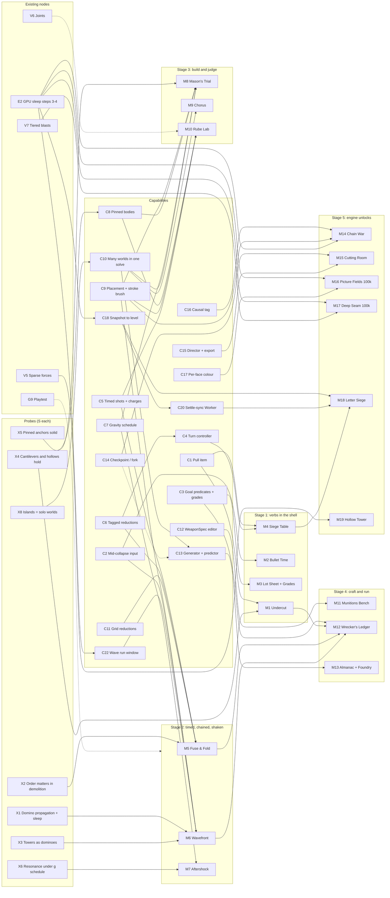

# Game modes roadmap: 172 ideas, 14 families, 19 modes, one capability DAG

Status 2026-11-05, main at `f827881`. Nothing here is built. It sits above [spectacle-mode.md](spectacle-mode.md) (the shell every mode below reuses) and next to the work DAG in `/mnt/project-files/plan/roadmap-dag.md`; node ids here (`X`, `C`, `M`, and `V4` to `V7`) do not collide with that DAG's `W`, `F`, `G`, `E`, `V1` to `V3` and `P` ids. The raw idea files from the divergent pass are in [mode-ideas/](mode-ideas/README.md); their full index with scores is Appendix A.

Will's ask (2026-11-05): modes that mix Jenga, dominoes and other block games with a twist, plus best-of-breed mechanics from other games, going wide first and then converging on a deep roadmap of modes, levels and capabilities built up over time.

## 0. Summary

- **Go wide:** seven designer agents, one per lens (stacking and balance, chain reactions and dominoes, destruction, puzzle, competitive, sandbox, progression), wrote 172 ideas against one capability brief. Each idea names its fun hook, the mechanic it borrows and from where, what 1k / 10k / 100k blocks change, what exists today and what is new.
- **Converge:** the ideas fall into 14 families. The strongest signal is convergence: **demolition sequencing** (charges on a timeline, or domino fuses, dropping a building into its footprint) was proposed independently by five of the seven lenses, **chain reactions at scale** by five, **precision removal** (the Jenga verb as a weapon) by four, **weapon crafting** by four.
- **Engine findings** that change costs (section 2): removal already wakes sleeping neighbours; gravity is written every step, so earthquakes, tilts and rolling decks are a small change; pinned (immovable) bodies are mostly built, because a sleeper is already an infinite-mass anchor; and one primitive, many worlds in one solve, serves a player mode (Chorus), a robustness judge and 10x cheaper star casting.
- **Recommendation:** build **verbs first**, inside the existing Keystone shell, so each new verb becomes a mode that reuses levels, rules, replays and the casting bot. Stage 1 is four small pieces: **Undercut** (pull blocks as ammo: Jenga as a weapon and as push-your-luck), **Bullet Time** (freeze a collapse mid-air and add a shot; echo loops), **Lot Sheet** (five side goals per level, no casting), and **Siege Table** (hot-seat duels on one device). Stage 2 adds **Fuse & Fold** (timed demolition, domino fuses) and **Wavefront** (dominoes and towers-as-dominoes, 1k to 10k). Eight cheap probes (section 7) run first, because three families depend on physics behaviour nobody has measured (domino propagation, buildings folding rather than crumbling, cantilevers holding).
- **Dominoes and Jenga specifically:** Jenga's "take without toppling" is Undercut's bank mode; "the pull is the weapon" is its aim mode; the literal held friction pull waits for sparse forces (weapons step 5/6, here `V5`). Dominoes enter as fuses (Fuse & Fold), as levels (Wavefront), as territory (Chain War) and as 100k picture fields (Picture Fields, after GPU sleep compaction).

## 1. How this was made

1. **Brief.** One capability brief (engine shapes and events, WeaponSpec, observers, sleep status, determinism per device only, the camera rule, the Keystone shell and its bot-cast stars, the earlier concept panel's five concepts) so that every agent argued from the same facts.
2. **Divergent pass.** Seven agents in parallel, 20 to 25 ideas each, at least three hybrids and three deliberately wild ideas per lens, one schema per idea, self-scored 1 to 5 on fun, novelty, engine fit and cost. Borrowed mechanics are named with their source game; every mode has an original name and nothing recreates a specific game's name, art, look or levels.
3. **Clustering.** Every idea is assigned to one of 14 families (Appendix A). Families are scored on how many lenses reached them independently.
4. **Hybridizing.** Within and across families, the strongest ideas are merged into 19 candidate modes (section 4), each a superset of several raw ideas.
5. **Ranking.** Modes are scored by me (not the designers), weights `0.35 fun + 0.15 scale leverage + 0.20 engine fit + 0.20 cost + 0.10 novelty`. Fun leads because the game's goal is fun; scale leverage is its own criterion because the engine's reason to exist is 10k to 100k blocks, and a mode where scale is decoration does not use it.
6. **Verification.** The engine claims the ideas lean on were checked against the code (section 2, marked *verified* with a file reference) or turned into probes (section 7).

**Caveats.** The designer self-scores are optimistic about cost and engine fit (a designer does not see the solver), and each lens rates its own ideas against its own lens; they are used only for the appendix ordering and the family means, not for the build order. Convergence is evidence, not proof: five lenses reaching demolition sequencing says it is the most natural new decision this engine offers, not that it is fun; the playtest decides that.

## 2. What the go-wide surfaced about the engine

| # | Finding | Status | Consequence |
|---|---|---|---|
| 1 | **Removal wakes what it touched.** The GPU engine adds a zero-impulse blast around every removed body, which sets the awake bit of everything in reach (`packages/physics-gpu/src/engine.ts` near line 487; the rationale is in `sleep.ts`'s header: a contact-loss rule woke whole towers at random). | Verified | The destruction lens listed "remove must wake neighbours" as a blocker for five ideas; it is already done. Every removal mode is unblocked on the GPU. |
| 2 | **Gravity is written every step** (`engine.ts` line 493, `solver.writeParams(n, dt, scene.gravity, ...)` inside `step`). | Verified | A gravity schedule `g(step)` is a small change. In the ground's frame, a shaking or tilting ground is exactly a time-varying gravity vector, so earthquakes, tilt tables and rolling decks need no kinematic bodies. A change must wake every sleeper, which the same zero-impulse blast can do with an unbounded radius. On screen the ground does not move, so a quake shakes or tilts the rendered world, never the camera (Will's camera rule). |
| 3 | **Pinned bodies are mostly built.** A sleeper is already an anchor: fixed pose, zero velocity, solved against as an infinite mass (`sleep.ts` header, `solver.ts` line 157). A body that is asleep and never wakes is a static body. | Verified (mechanism); the flag is new | The lenses rated "static bodies" medium, engine-wide. On the GPU it is a small flag on top of sleep; the reference engine and the Rapier adapter each need their own (Rapier has fixed bodies). Unblocks ramps, pegs, bins, tables, cliffs and plinths for five families. |
| 4 | **Sleep wakes a whole touching group.** One wake wakes every sleeper joined to it through contacts (`sleep.ts` header). | Verified | In Fall Line and Cityfall the awake set is whole towers at the front, not the struck blocks. A domino field is spaced, so each domino is its own group and the awake set is the wave front only. |
| 5 | **A slowly tipping domino will not be frozen mid-fall by sleep.** A body sleeps only after 30 quiet steps below 0.05 units/s **and** under 2% of its radius of drift over the window (`DEFAULT_SLEEP`). A real tip moves far more than that. | Verified rule; behaviour to probe (X1) | The chains lens flagged this as a risk; the drift window already covers it. Leaning dominoes that are held still (a "cocked" sculpture) must stay asleep, which X1 also checks. |
| 6 | **A uniform world shove is possible today:** a blast centred very far away with a flat core and `maxDv` set to the wanted speed gives every body in reach that speed. | Claim | A cheap stand-in for wind gusts and jolts before the gravity schedule. `TieredEngine` refuses blasts, so not at 100k until tiered blasts (`V7`). Probe X6. |
| 7 | **Domino waves travel at roughly 1 to 1.5 times sqrt(g h)**, about 3 to 5 m/s for 1 m dominoes. A straight line of 100k at 0.6 m spacing is 60 km. | Estimate (chains lens) | 100k dominoes only make sense as a 2D field (about 300 by 300, 180 m across, roughly 45 s for a front to cross) or many branches. Settle v2's 30 s cap must lengthen for wave levels. The front of a radial wave at 90 m is about 3k bodies, which runs at 60 Hz on the M5. |
| 8 | **Plan-then-watch modes tolerate slow physics.** Where the player plans and then watches (timed demolition, quake design, a director replay), 100k at 21 to 37 ms a step plays as deliberate slow motion through the existing slow-motion valve, or renders offline frame by frame. | Reasoned | 100k becomes playable in these modes before it runs in real time. |
| 9 | **Determinism per device is a feature for some modes.** Hot-seat is fair on one machine; a time loop re-fires your earlier shots bit for bit; a reverse puzzle generated on your own device can be matched exactly; a branch tree is just `(level, shots, step)`. | Reasoned | Time control (section 4, M2, M15) and on-device puzzles lean into it rather than around it. |
| 10 | **Async online play without cross-device determinism:** exchange the world only at rest ("settle-sync"). After a turn settles, the shooter uploads its inputs and the settled state of the bodies that moved (about 50 to 70 KB at a 5k-body collapse); the next player loads that state as canonical and never re-simulates it. | Reasoned (competitive lens) | Turn-based remote play works on the existing Cloudflare KV, at the cost of one new capability: load a settled state as a level, at rest (C18). Cheating is a forged state; plausibility checks only, friends only. |
| 11 | **Many worlds in one solve.** The ground is infinite, so K copies of a small level placed far apart run in one engine. | Claim; probe X8 | One primitive (C10) gives a player mode (Chorus: one shot into 64 jittered worlds, scored on how many clear), a robustness judge for building modes (no placement bot needed), and 10 to 40x cheaper casts of small levels (progression lens estimate). Not bit-identical to a solo run (colouring is global), so only statistics may depend on it. |
| 12 | **Scoring holes.** Pull-only levels fire 0 J, so leverage divides by zero; placement and timing verbs cannot be searched by today's shot bot. | Reasoned | Charge a nominal energy per pull (C1). Prefer scoring that needs no cast for non-shot verbs: binary goals, a robustness multiplier from many worlds, personal bests (section 5, rule R3). |
| 13 | **Remove plus respawn is an instantaneous velocity or material change** of one body (a tablecloth yank, moving a block, repainting it ice). | Reasoned | Several "new capability" asks are buildable from today's events; the body's warm-start is lost for one step. |

## 3. The idea space: 14 families

Ideas per family, how many of the seven lenses proposed something in it, the designers' mean weighted score (`0.4 fun + 0.15 novelty + 0.25 fit + 0.2 cost`), and the best raw ideas. Full list in Appendix A.

| Family | Ideas | Lenses | Mean | Best raw ideas | The hook |
|---|---|---|---|---|---|
| Demolition sequencing | 5 | 5 | 4.28 | CH-9 Fuse Line, DE-1 Implode, SB-21 Implosion Score, ST-16 Clean Drop, PZ-20 Implosion Order | Order in time is the decision: core first, perimeter 0.3 s later, and the building folds into its own lot instead of onto the chapel |
| Weapon craft | 4 | 4 | 4.19 | PZ-16 Fusecraft, PR-14 Armory Bench, SB-22 Munitions Workshop, DE-3 Forge & Fire | The weapon is the creation: compose WeaponSpec triggers and splits, test, field it |
| Time control | 8 | 3 | 4.18 | DE-9 Stopframe, DE-8 Never Settle, DE-16 Recurrence, PZ-19 Echo Volley, SB-14 Forking Paths, SB-13 Cutting Room | Freeze a 10k collapse in mid-air and read it; re-fire your past shots in a loop; keep a combo alive while the world moves |
| Precision removal | 10 | 4 | 3.95 | ST-8 Sapper, DE-11 Keyhole, PZ-5 Hollowing, DE-23 Skeleton Crew, ST-25 Whisk, CH-10 Hair Trigger | The Jenga verb: one pull aims a collapse, or take as many as you dare before it goes |
| Chain reactions and waves | 18 | 5 | 3.88 | CH-3 Firebreak, CH-16 Cityfall, DE-13 Fall Line, DE-10 Sympathetic, CH-2 Wakefield, CH-1 Toppletrail, CH-7 Outrun | One push, a long watch; at scale, a front crossing a city or a 100k field revealing a picture |
| Outcome targets and trick shots | 10 | 3 | 3.88 | PZ-17 Chorus, PZ-2 Assay, PZ-3 Shadowfall, DE-4 Rubble Writ, PZ-13 Half Measures | Aim at where the rubble ends up; distributions are stable at 10k even when single bodies are chaotic |
| Build, then test | 10 | 5 | 3.85 | SB-19 Daily Seventeen, ST-22 Corbel, SB-3 Load Test, DE-6 Safe Room, DE-20 Deflection | Place blocks from a budget, then the test (a ball rolls over the bridge, the quake, the collapse onto your shelter) |
| Deduction and hidden information | 12 | 4 | 3.85 | PZ-18 Invisible Ink, PZ-4 / DE-24 Aftermath, PZ-1 Sounding Line, DE-22 Bracket, PZ-8 Six Stones | Read evidence: rubble that tells you the shot, an invisible structure revealed by touch, X-ray as a scarce resource |
| Versus and social | 31 | 7 | 3.84 | CO-16 Sealed Orders, CO-15 Chain War, CO-2 Two Keeps, CO-11 Heraldry, CO-21 Called Order, ST-7 Mason and Mole | Every shot is attack and exposure; hot-seat is fair on one device |
| Meta, progression, content supply | 24 | 6 | 3.76 | PR-2 Wrecker's Ledger, PR-8 Lot Sheet, PR-11 Collapse Museum, PR-6 Foundry, PR-4 Almanac | Structure that brings players back, and levels that do not each cost an hour of Mac GPU |
| Creative and expressive | 19 | 5 | 3.63 | SB-12 Shatterprint, SB-7 Rube Lab, SB-23 Rubble Breeder, SB-10 Flipfield, SB-9 Fallline | Make things: contraptions, music from impacts, a photo as a wall to wreck |
| World forces | 8 | 4 | 3.56 | DE-15 Richter, ST-4 Aftershock Architect, DE-21 Meltdown, PZ-23 Snowglobe | You design the earthquake; resonance drops the tall towers and spares the squat ones |
| Persistent mega-worlds | 6 | 4 | 3.48 | DE-12 Undermine, ST-18 Deep Seam, PR-18 The Spire, DE-7 Stomp Path, PR-19 Standing City | Only possible because of sleep: a 100k world where cost follows what you touch |
| Dexterity stacking and held pulls | 7 | 2 | 3.45 | ST-1 Hollow Tower, CO-1 Last Pull, ST-23 Libra Stack, CO-24 Babel Race | The literal Jenga hand and stacking races; the weakest fit to a mouse and to scale |

Independent convergences worth naming, since each is two or more lenses reaching the same mode: Implode (5 lenses), Fall Line / Cityfall (3), Aftermath (3), the run mode with the rack as economy (4: PR-2, CH-18, ST-15, DE-19), Two Keeps / Rampart Duel (2), Turf Fronts / Chain War (2), Undermine / Deep Seam (2), Recurrence / Echo Volley (2), Corbel / Load Test (2), Aftershock Architect / Tremor Table (2).

## 4. Converged modes

Each mode merges several raw ideas. "Casting" says how stars are set, because casting time on the M5 (about 1 h per 10k level) is the content bottleneck.

### M1 Undercut (precision removal; Stage 1)

- **Merges:** ST-8 Sapper, DE-11 Keyhole, PZ-5 Hollowing, DE-23 Skeleton Crew, ST-14 Skeleton Key, ST-21 Single Thread, ST-25 Whisk, CO-1 Last Pull (its loser rule, without the held pull).
- **What it is:** a `pull` rack item: click a block and it vanishes (`remove`). Two level kinds. **Aim:** pull 1 to 4 blocks so the structure falls the way you want (onto crowns, away from heritage, into the lot). **Hollow:** push-your-luck; take as many blocks as you dare while the capstone stays above the line, and bank before it goes. A `yank` item does the tablecloth trick (remove a slab and respawn it at speed). Hot-seat variant in M4: alternate pulls, whoever drops a crown loses.
- **Why it is fun:** the slow creak and lean, then the rush, is the spectacle Will responds to, aimed rather than fired. Hollow is Jenga's actual tension.
- **Scale:** 1k: choose a wall's topple direction. 10k: pulls start building-into-building cascades, and a hollowed 10k block grows arches by itself. 100k: the daily "one pull" (ST-21) once sleep compaction lands.
- **Needs:** C1 (pull item, nominal energy, brush). Optional C19 load X-ray and a creak voice.
- **Casting:** Aim levels use today's bot with pulls as candidate shots (enumerate structure bodies, much cheaper than aim search). Hollow is scored on mass removed, with T2/T3 cast the same way, or as personal best.
- **Risk:** loose-lattice columns are independent (findings section 3), so most pulls just drop one column. Levels need slabs, planks and Kapla interlocks; the probe X4 covers it.
- **Alternatives considered:** the cue rod (exists, but a 94 kg strike, not a pull, and wrong for planks); the held friction pull on sparse forces (the real Jenga feel, M19, waits for `V5`). `remove` first, because it is S, replayable and already wakes neighbours.

### M2 Bullet Time (time control; Stage 1)

- **Merges:** DE-9 Stopframe, DE-16 Recurrence, PZ-19 Echo Volley, DE-8 Never Settle, SB-15 Shutter Collapse.
- **What it is:** three switchable verbs on any level. **Freeze:** a limited number of times per level, stop the world mid-collapse, orbit it (the camera is the player's), and place one more shot into the frozen debris. **Echo:** each retry re-fires all your earlier shots at their recorded steps and adds one, so five loops compose one choreographed collapse. **Live chain:** a combo multiplier that stays alive while the moving-body count stays above a floor; fire before it settles to keep it.
- **Why it is fun:** a frozen 10k collapse is a puzzle you could never read in real time and the best screenshot the game makes. Echo makes a set piece no single shot can.
- **Scale:** freezing costs nothing at any scale, so a frozen 100k collapse browses at full frame rate.
- **Needs:** C2 (events stamped at the frozen or current step, quickdraw attribution and baseline rules, which spectacle-mode.md left unspecified on purpose).
- **Casting:** freeze levels need a bot policy over freeze times (M); first ship freeze as an option on existing levels with "custom: stars not recorded", and a few levels scored on airborne count or a landing pad.
- **Risk:** freeze at step 412 vs 413 changes outcomes; that is acceptable on one device. Players may over-deliberate; a freeze budget bounds it.
- **Alternatives considered:** full rewind (SB-14, needs checkpoints, C14; it also trivialises one-shot tension, so it belongs in the sandbox, M15).

### M3 Lot Sheet and Grades (content multipliers; Stage 1)

- **Merges:** PR-8 Lot Sheet, PR-10 Grades, PR-9 Escalation, PR-12 Field Guide (later), PR-13 Hand Ranks (later).
- **What it is:** five hand-written side goals per level, each a predicate over observers ("make a doorway: a 3 by 3 hole with the top row standing", "only the north tower falls", "win with the cue only"), proven once by a recorded play. Grades turn the cast clouds already written to `docs/game/levels/<id>.md` (P10 to P90) into five bands the player chooses between. Escalation ladders are lists of overrides with pass/fail rungs.
- **Why it matters:** about five times the play per level that already exists, with **no new casting**. It also teaches structure reading.
- **Needs:** C3 (goal predicate DSL and a one-play proof).
- **Risk:** goals proven on the M5 may be near-impossible on another device in chaotic regions; prove each with a margin (8 nudges pass at least 6).

### M4 Siege Table (versus, hot-seat; Stage 1)

- **Merges:** CO-2 Two Keeps / DE-2 Rampart Duel, CO-11 Heraldry, CO-16 Sealed Orders, CO-21 Called Order, CO-10 Armory Draft, ST-7 Mason and Mole, ST-9 Self-Quarry, Undercut duel.
- **What it is:** one turn controller and a set of rulesets on one device. **Two Keeps:** artillery duel between two forts, misses become terrain. **Heraldry:** one shared striped tower, score rival colours below the line, lose your own. **Called Order:** numbered crowns must fall lowest first; pot one and shoot again. **Sealed Orders:** a modifier where everyone programs a shot in secret and all launch on the same step. **Undercut duel:** alternate pulls. A draft phase picks racks.
- **Why it is fun:** with people in the room it is the most fun per hour of build; G9's playtesters are the first audience.
- **Scale:** 1k forts read shot by shot; 10k citadels become siege engineering; rubble ramps guide the next ball.
- **Needs:** C4 (turn controller, cover screen for secrets), C6 (counts per owner tag). No networking.
- **Casting:** none; versus modes are scored against the opponent.
- **Risk:** long settles drag turns (cap at 8 s with fast-forward); first-player advantage (mirror maps, alternate starts).
- **Alternatives considered:** online first (settle-sync, M18) needs C18 and a Worker; room codes with phones as controllers (CO-13) need Durable Objects. Hot-seat first costs neither and tests whether the rules are fun.

### M5 Fuse & Fold (demolition sequencing; Stage 2)

- **Merges:** DE-1 Implode, CH-9 Fuse Line, SB-21 Implosion Score, ST-16 Clean Drop, PZ-20 Implosion Order, DE-10 Sympathetic.
- **What it is:** place charges on a building and give each a delay on a timeline, or lay domino fuse lines from a plunger to charge sockets (the fuse length is the delay, and you can see it tick). Press the plunger; the building should fold into its own lot, missing the heritage neighbours. Sympathetic levels have dormant charges that fire when jolted, and you place relays.
- **Why it is fun:** it is the real demolition engineer's problem, a new decision (order in time) the game does not have, and its payoff is a building kneeling into its footprint. Deterministic replay makes every retry an exact experiment.
- **Scale:** 10k is the sweet spot (a core and a shell); 100k city blocks play as planned slow motion (finding 8) and need tiered blasts (`V7`).
- **Needs:** C5 (a shot that carries a timeline of events; level-owned charges at rest; a WeaponSpec action that removes a named target; a "moved" trigger for sympathetic charges), C11 (footprint spread and rubble height), C6 (per-region collapse). Domino fuses also need the stroke brush from C9.
- **Casting:** distribution-scored (footprint spread, heritage), so the existing recipe works; candidates are charge sets and delay vectors on a coarse grid.
- **Risk (the big one):** a loose-cube building may fall the same way whatever the order, so sequencing would not matter. Probe X2 measures exactly that before anything is built; if it fails, buildings need slab floors and plank cores (S14 variants) until it passes.
- **Alternatives considered:** blasts only (no removal charges): simpler but cruder; sparse cutting forces: waits for `V5` and buys little.

### M6 Wavefront (dominoes and towers as dominoes; Stage 2, 100k in Stage 5)

- **Merges:** CH-1 Toppletrail, CH-3 Firebreak, DE-13 Fall Line, CH-16 Cityfall, ST-13 Fuse Pull, CH-12 Ripple Tap, CH-4 Stopline, CH-17 Synchrony, CH-21 Gapfill, CH-7 Outrun.
- **What it is:** a domino level family with three verbs. **Lay:** draw a run with a budget from the push to the crowns, past stairs, gaps and corners. **Cut:** a wave is already running toward a village; remove dominoes and drop slabs to stop it (physics does not pause). **Steer:** a skyline is the domino layout; pick the first tower and place girders or relay charges so the fall crosses the avenues to the target square. Side kinds: stop the chain as close to a line as possible without crossing it; make three bells ring within 0.2 s.
- **Why it is fun:** one push and a long, ticking, tense watch; Firebreak's triage is the most immediate fun in the chains lens.
- **Scale:** 1k lines with stunts; 10k cities whose towers topple into each other; 100k fields only as 2D fields (finding 7), where only the front is awake.
- **Needs:** C9 (the stroke brush subset of placement: auto-spaced, tangent-aligned dominoes), C2 (live input for Cut), C22 (longer run window), C6, an opt-in front-follow camera (exists as `keystone.follow`) and a 2D wave-map overlay (a picture, not camera motion).
- **Casting:** Lay levels have budget stars from a bot that perturbs authored solutions; Cut levels need a scripted cut policy, or are scored on dominoes saved against personal best.
- **Risks:** corner reliability and AVBD fan-out in fields (probe X1); towers crumbling instead of tipping as a unit (probe X3; B4 Domino Boulevard's Rapier probe already showed 6 to 15 column chains working and long ones stalling).

### M7 Aftershock (world forces; Stage 2)

- **Merges:** DE-15 Richter, ST-4 Aftershock Architect, SB-4 Tremor Table, ST-6 Heavy Weather Hold, DE-21 Meltdown.
- **What it is:** first, **design the quake**: pick amplitude, frequency and duration within an energy budget so the condemned towers fall and the protected ones stand (no placement needed). Later, with C9, **retrofit**: 200 blocks to brace a 10k city before the quake.
- **Why it is fun:** resonance is visible and surprising; tall towers fall to slow sway and squat ones to sharp jolts.
- **Needs:** C7 (gravity schedule and wake-all). Small, because gravity is already written every step (finding 2).
- **Casting:** distribution-scored (towers down by class); candidates are a small grid of quake parameters, cheap.
- **Risk:** friction-held stacks may slide rather than resonate; probe X6. A quake wakes everything, so 100k is slow motion only.
- **Built (2026-11-07):** docs/game/aftershock.md. X6 ruled out resonance, so the levers are amplitude through slenderness, size, duration and the axis against bonded walls; the verify is a threshold curve, not a resonance curve. Levels A1 to A3 passed the choice-matters gate; stars on quake energy.

### M8 Mason's Trial (build, then test; Stage 3)

- **Merges:** ST-22 Corbel, SB-3 Load Test, ST-3 Outreach, PZ-21 Overhang, DE-6 Safe Room, PZ-6 Bulwark, CH-24 Breakwater, DE-20 Deflection, SB-19 Daily Seventeen, SB-2 Plank Hall.
- **What it is:** place blocks from a budget with time stopped, then the test: a bowling ball rolls over your jointless bridge, the quake, the collapse onto your shelter, the boulder flood against your berm. The score is multiplied by robustness: your build is copied into 64 jittered worlds and judged on how many pass (Daily Seventeen's judge).
- **Why it is fun:** "will it stand?" with physics as the referee; the absence of joints becomes the theme (corbels, counterweights, arches).
- **Needs:** C9 (the full placement tool), C8 (pinned cliffs and tables), C7 (quake tests), C10 (the robustness judge).
- **Casting:** the robustness judge replaces a placement bot (rule R3): stars are pass fractions and budget left, with T2/T3 from a few author solutions.
- **Risk:** cantilevers and long stacks creeping at game settings (probe X4); mouse placement ergonomics.

### M9 Chorus (outcome distributions; Stage 3)

- **Merges:** PZ-17 Chorus, plus the many-worlds machinery shared with M8 and M13.
- **What it is:** your one shot is fired into 64 copies of a small level, each jittered by a hair; the score is how many of the 64 clear. It turns the engine's hardest fact, chaos, into the puzzle, and teaches what the bot's robustness gate measures.
- **Scale:** 100 bodies x 64 = 6.4k, real time today; 1k x 64 plays back after compute.
- **Needs:** C10.
- **Why build it:** cheap once C10 exists, and C10 pays for itself through faster casting (M13) regardless of whether Chorus is fun.

### M10 Rube Lab (contraptions; Stage 3, hinges with `V6`)

- **Merges:** SB-7 Rube Lab, CH-8 Contraption Kit, CH-5 Gatework, PZ-7 Fallgate.
- **What it is:** a parts bin of boxes, spheres, dominoes, pinned ramps and proximity grenades as fuses; ring the bell. Domino logic gates as a chapter. Hinges, levers and pendulums arrive with joints (`V6`).
- **Needs:** C8, C9, C5 (charges as parts).
- **Risk:** without joints the vocabulary is thin (no pivots), so this is Stage 3, not earlier.

### M11 Munitions Bench (weapon craft; Stage 4)

- **Merges:** PZ-16 Fusecraft, SB-22 Munitions Workshop, PR-14 Armory Bench, DE-3 Forge & Fire.
- **What it is:** a visual tile editor over WeaponSpec (triggers, splits, blasts, removes; depth 3) with a firing range, contracts ("take off exactly the top half"), cost histograms of your own past solutions, and parts unlocked by progression. WeaponSpec is already pure data with a validator and a static budget, so this is mostly UI.
- **Needs:** C12 (editor and budget caps so a shared weapon cannot overload a device). Relative spawn (`V4`) and thrust (`V5`) add tiles later.
- **Risk:** a rules language is abstract; start from presets and two-tile programs. Custom weapons stay out of official star runs unless a level allows them.

### M12 Wrecker's Ledger (run mode; Stage 4)

- **Merges:** PR-2 Wrecker's Ledger, CH-18 Long Fall, ST-15 Borrowed Height, DE-19 Wrecking Ledger, PR-3 Spoil Heap (as a permit), PR-22 Relay.
- **What it is:** a roguelike run over 8 shuffled lots drawn from every cast level of every mode. The rack is the wallet: leverage earns cash, cash buys rack items and permits that bend scoring ("blasts on ice double", "heritage counts as crowns"). Boss lots at 10k. This is the earlier concept panel's BREAKLINE, with the rack as the economy instead of chips times mult.
- **Needs:** C3 (goals), a pool of at least 20 cast levels across modes (M1, M5, M6), and later C13 to keep the pool growing.
- **Risk:** permits that change physics alter the level hash and invalidate cast thresholds; quotas use a conservative fallback.

### M13 Almanac and Foundry (content supply; Stage 4)

- **Merges:** PR-4 Almanac, PR-6 Foundry, PR-20 Seed Scouts, PR-5 Crowdcast (later), SB-17 Seedworks.
- **What it is:** a structure generator over the scenario builders (colonnades, tenements, Kapla spires) with knobs; a nightly cast job on the Mac publishes one daily lot (1k to 3k) and one weekly 10k lot; every past day stays playable, no streaks.
- **Needs:** C13 (generator, threshold predictor with an error bar, auto-reject on gate failure), C10 (island-batched casting), optionally C14 (GPU fork, 2 to 3x).

### M14 to M19 (Stage 5: engine unlocks)

| Mode | Merges | What it is | Waits on |
|---|---|---|---|
| **M14 Chain War** | CO-15, CH-6 | Go with dominoes: two players lay dominoes into a shared 10k neutral field, then each fires one push; every toppled domino takes the colour of the wave that toppled it; fronts annihilate where they meet; most territory wins | C16 contact-propagated tag, C9, E2 sleeper grid for 100k |
| **M15 Cutting Room** | SB-13, SB-14, PR-11 Collapse Museum | A replay director: scrub, keyframe the camera, ramp slow motion, switch looks, export video, including 100k collapses rendered offline; branch trees in the sandbox; a museum of your best collapses | C14 checkpoints (or re-simulation), C15 offline render and export |
| **M16 Picture Fields** | SB-10 Flipfield, CH-2 Wakefield | A 100k domino field is a picture from above; push it and the fallen faces reveal a second picture; three pushes, gold regions to reveal | E2 step 3 compaction and step 4 sleeper grid, C17 per-face colour, C22, an image-to-field compiler with feeder lines |
| **M17 Deep Seam** | ST-18, DE-12 Undermine, DE-7 Stomp Path | Tunnel into a sleeping 100k mesa toward a gem and prop the roof; or plot a kaiju's footsteps through a 100k city | E2 steps 3 and 4, tiered blasts `V7`, a cutaway render |
| **M18 Letter Siege** | CO-14, CO-3 Build then Breach | Siege Table across devices by settle-sync (finding 10); a match lasts days | C18 snapshot to level at rest, C20 settle-sync Worker |
| **M19 Hollow Tower** | ST-1, CO-1, SB-2 | The literal Jenga hand: a held, capped finger force drags neighbours by friction; keep pulling or let go | Sparse forces `V5` with a GPU-side spring-to-target grab |

## 5. Ranking

Scores are mine (1 to 5), weights `0.35 fun + 0.15 scale + 0.20 fit + 0.20 cost + 0.10 novelty`.

| Rank | Mode | Fun | Scale | Fit | Cost | Novelty | Score | Stage |
|---|---|---|---|---|---|---|---|---|
| 1 | M2 Bullet Time | 5 | 4 | 5 | 4 | 5 | 4.65 | 1 |
| 2 | M5 Fuse & Fold | 5 | 5 | 4 | 4 | 4 | 4.50 | 2 |
| 3 | M1 Undercut | 4 | 4 | 5 | 5 | 3 | 4.30 | 1 |
| 3 | M6 Wavefront | 5 | 5 | 4 | 3 | 4 | 4.30 | 2 |
| 5 | M7 Aftershock | 4 | 3 | 5 | 4 | 4 | 4.05 | 2 |
| 5 | M12 Wrecker's Ledger | 5 | 4 | 4 | 3 | 3 | 4.05 | 4 |
| 7 | M11 Munitions Bench | 4 | 4 | 5 | 3 | 4 | 4.00 | 4 |
| 7 | M14 Chain War | 5 | 5 | 3 | 2 | 5 | 4.00 | 5 |
| 9 | M4 Siege Table | 4 | 3 | 5 | 4 | 3 | 3.95 | 1 |
| 10 | M15 Cutting Room | 4 | 5 | 4 | 3 | 3 | 3.85 | 5 |
| 11 | M9 Chorus | 3 | 3 | 5 | 4 | 5 | 3.80 | 3 |
| 12 | M3 Lot Sheet and Grades | 3 | 3 | 5 | 5 | 2 | 3.70 | 1 |
| 13 | M16 Picture Fields | 4 | 5 | 3 | 2 | 4 | 3.55 | 5 |
| 14 | M13 Almanac and Foundry | 4 | 3 | 4 | 3 | 2 | 3.45 | 4 |
| 14 | M17 Deep Seam | 4 | 5 | 2 | 2 | 5 | 3.45 | 5 |
| 16 | M8 Mason's Trial | 4 | 3 | 4 | 2 | 3 | 3.35 | 3 |
| 17 | M18 Letter Siege | 3 | 3 | 4 | 3 | 4 | 3.30 | 5 |
| 18 | M10 Rube Lab | 4 | 3 | 3 | 3 | 2 | 3.25 | 3 |
| 19 | M19 Hollow Tower | 4 | 2 | 3 | 3 | 2 | 3.10 | 5 |

**Why the build order is not the score order.** Four rules, applied in order:

- **R1 Dependencies first.** A mode cannot start before its capabilities (section 6).
- **R2 Cheap multipliers early.** M3 ranks 12th on fun but multiplies the play of every level that exists and needs no casting, so it is Stage 1. M4 ranks 9th but is the only Stage 1 mode the G9 playtest group can play together.
- **R3 Prefer scoring that needs no cast** for non-shot verbs (placement, timing, live input): binary goals, a robustness multiplier, personal bests, or versus. Casting stays for shot-based levels, where today's bot already works.
- **R4 Probe before building** wherever a family rests on unmeasured physics (section 7). M5 and M6 rank 2nd and 3rd but wait for X1 to X3.

**Ranked down, and why.** Dexterity stacking races (ST-11 Topple Sprint, CO-24 Babel Race): fun but the genre exists and scale adds nothing. Mega-world persistence as a forever mode (PR-19 Standing City, PR-18 The Spire): the most novel, but they need save and restore at 100k, sleep compaction and tiered blasts at once. Music modes (SB-8 Clatterhymn, CH-14 Click Track, SB-9 Fallline): delightful toys, but 60 Hz steps quantise tempo and the synth voices 8 impacts; revisit after C21. Public leaderboards (CO-22 Proving Ground, PR-5 Crowdcast): need a population and an always-on verifier. Async base raiding (PR-24 Siegeworks): the raider's outcome is not the defender's (no cross-device determinism), the same reason the earlier panel deferred it.

## 6. Capabilities

Effort: S = one PR; M = 2 to 4 PRs; L = 5 or more. Layer says which packages change.

| Id | Capability | Effort / risk | Layer | Depends on | Unlocks |
|---|---|---|---|---|---|
| C1 | `pull` rack item (remove a clicked body), nominal energy for 0 J actions so leverage stays defined, brush removal (many removes in one event), a vanish puff and creak | S / low | keystone, game | none | M1, M4 duel |
| C2 | Mid-collapse input: freeze and fire at the current step, events stamped at that step, quickdraw attribution and settle-baseline rules, a freeze budget | S-M / low | keystone driver, game | none | M2, M6 Cut |
| C3 | Goal predicate DSL over observers, a one-play proof per goal, grade bands from cast clouds, ladder manifests | S-M / low | keystone | none | M3, M12 |
| C4 | Turn controller (settle or 8 s cap, fast-forward), hot-seat, owner ink per player, cover screen for secret orders | S / low | game | C6 | M4 |
| C5 | Timed multi-event shots: one shot carries a timeline; level-owned charges placed at rest; WeaponSpec `removeTarget` action and `moved` trigger (displacement or speed above a threshold) | S-M / low | weapons, keystone | none | M5, M10 |
| C6 | Tagged reductions: count, mass and PE by owner tag, material and region; more than 64 key bodies via tag masks | S-M / low | engine-api observe (GPU path with E3) | none | M4, M5, M6, M14 |
| C7 | Gravity schedule `g(step)` from quantised level data, wake-all on change; optional `fieldKick` event (uniform dv in a box or height band) | S / low | engine-api, physics-gpu, physics-ref, adapter-rapier | none (finding 2) | M7, M8 |
| C8 | Pinned bodies: a never-wake anchor flag on the GPU (finding 3), the equivalents in the reference engine and Rapier | S / low-med | engine-api, all engines | E2 steps 1 to 2.1 (done) | M8, M10, outcome levels with bins and walls |
| C9 | Placement tool: edit mode (time stopped, rebuild exactly on Play), ghost, face snap, rotate, overlap check, budget, course stamps, and a stroke brush that lays dominoes along a path | M / low | game, viewer | none | M6 (stroke subset), M8, M10, M14 |
| C10 | Many worlds in one solve: K islands far apart, per-island observers and events | M / med | engine-api observe, keystone-lab | X8 | M8 judge, M9, C13 |
| C11 | Grid reductions: occupancy, heightmap and projection histograms with a target-mask distance (fill, spill, IoU) | S-M / low | engine-api observe | none | M5 footprint spread, outcome targets (Shadowfall, Rubble Writ), Aftermath |
| C12 | WeaponSpec visual editor with live arc preview and budget caps | M / low | viewer, game | V3 (done) | M11 |
| C13 | Structure generator families, feature extraction, threshold predictor with error bars, nightly cast job | M / med | keystone-lab, scenarios | C10; C14 optional | M13, M12 pool |
| C14 | Checkpoint and restore of GPU state (with warm-start and sleep state), and `fork()` | M / med | physics-gpu | none | M15, on-device bots, 2 to 3x faster casts |
| C15 | Director: camera keyframe track, offline fixed-step render, WebM export with audio | M / med | viewer, render, audio | C14 soft (re-simulation also works) | M15 |
| C16 | Contact-propagated tag: a body woken by contact inherits the waker's tag (causal ink) | M / med | physics-gpu | none | M14, better shot ink everywhere |
| C17 | Per-face and per-body base colour in scene data and shaders | S / low | render, schema | none | M16, Shatterprint |
| C18 | Snapshot to level: save a settled state quantised and load it at rest, asleep | M / med | physics-gpu, keystone | E2 | M18, Spoil Heap permit |
| C19 | Per-body carried load (contact multipliers, smoothed) for a load X-ray | M / med | physics-gpu | none | M1 hints, Sounding Line |
| C20 | Settle-sync Worker on Workers KV (rooms, turn tokens, state deltas) | S-M / low | playtest | C18 | M18 |
| C21 | Impact event log available to rules (step, bodies, impulse) | S-M / low-med | physics-gpu, audio | none | music modes, Field Guide |
| C22 | Wave-friendly run window: settle cap longer than 30 s for wave levels; bodies spawned asleep | S / low | keystone, physics-gpu | E2 | M6, M16 |

Existing work this roadmap leans on (no new ids): **E2** GPU sleep (steps 3 compaction and 4 persistent sleeper grid), **E3** GPU reductions, **G9** playtest. Weapons plan steps 5 to 8 have no ids in the work DAG; this document names them **V4** relative spawn, **V5** sparse forces and kicks, **V6** joints, **V7** tiered blasts (the V lane is "look, weapons, reach", and V3 was weapons step 4).

## 7. Probes (run before Stage 2 and 3; each is one small PR plus a Metal run)

| Id | Question | Setup | Pass means | Gates |
|---|---|---|---|---|
| X1 | Do domino runs propagate on AVBD at game settings, and does sleep leave them alone? | A 200-domino line at 0.6 h spacing; curves of radius 3, 5 and 8 h; a 100 by 100 brick-offset field; sleep on and off; SwiftShader and Metal | Line and curves of radius 5 h or more reach the end in at least 98% of 32 nudges; the field front reaches 95% of dominoes; no domino asleep at a tilt between 5 and 80 degrees; a cocked (leaning, held) domino stays asleep for 60 s; awake count at the front is logged | M6, M16, C22 |
| X2 | Does order matter when a building comes down? | S14 building and a slab-floor variant, 4 charges; all at once vs core first then perimeter at 0.2 to 0.5 s; 32 nudges each | The footprint metric differs between orders by at least 0.1 of its range (the skill gate) on one design | M5 |
| X3 | Do towers fall as dominoes? | Chains of 6, 12 and 24 slender bonded towers (Kapla and cube bond patterns) | At least one design propagates 12 towers in 80% of nudges | M6 Steer |
| X4 | Do cantilevers and hollowed structures hold at rest? | Harmonic overhang stacks at 95% and 105% of the theoretical overhang; a corbelled 3 m span; a 1k wall hollowed to an arch; 3,600 steps at 20 and 40 iterations | 95% stacks hold and 105% stacks fall; the span holds 60 s and carries a bowling ball in 80% of nudges; the arch holds | M1 Hollow, M8 |
| X5 | Are never-wake anchors solid? | A pinned slab struck by a cannonball; a pinned ramp under a 1k marble flood | No pinned body moves; neighbours match an all-awake reference within the existing quality gates | C8 |
| X6 | Do friction stacks show resonance under a gravity schedule? Does the distant-blast shove work? | Towers of height 5, 10 and 20 cubes on a sinusoidal horizontal g at 0.5 to 4 Hz; a far flat-core blast with `maxDv` | The tall tower's failure frequency is lower than the short tower's (a monotone curve); every body receives the capped dv within 1% | M7 |
| X7 | (Optional, curiosity) Does AVBD survive a 1.5x domino amplifier over 20 pieces (a mass ratio of about 10^10)? | 1 cm to 30 m dominoes | No NaN, the chain propagates | CH-19 Amplifier as a showcase |
| X8 | Do islands behave like solo worlds? | 64 islands of a 150-body level vs 64 solo runs of the same jittered shots | Outcome distributions match (two-sample KS test, p above 0.05); cost per body within 10% of a solo 9.6k scene | C10 |

## 8. The staged DAG

**Stage gates.**

| Stage | Contents | Starts when | Done means |
|---|---|---|---|
| 0 | Probes X1 to X6 and X8 | now (SwiftShader in CI; one Metal batch when the Mac is idle) | Each probe's pass or fail is recorded in `docs/game/mode-probes.md`; a failed probe changes the mode's level grammar or parks it |
| 1 | C1, C2, C3, C4 (+C6 minimal) → M1, M2, M3, M4 | now; all S, all inside the shell | Each mode has 3 levels (or rulesets) playable on the playtest build behind a switch; Undercut aim levels cast; Lot Sheets on B1 to B3 and L1 to L5 |
| 2 | C5, C7, C9 stroke brush, C11, C22 → M5, M6 (1k to 10k), M7 | G9 has reported, and X1, X2, X3, X6 have passed for the mode in question | Three cast levels per mode; Wavefront Cut and Lay; Fuse & Fold with charges and domino fuses |
| 3 | C8, C9 full, C10 → M8, M9, M10 | X4, X5, X8 passed | Mason's Trial with the robustness judge; Chorus on 3 levels; Rube Lab chapter 1 |
| 4 | C12, C13 → M11, M12, M13 | at least 20 cast levels exist across M1, M5, M6 | A run of 8 lots; a daily lot published from a nightly cast; the bench with a range |
| 5 | C14 to C18, C20, plus E2 steps 3 and 4, V5, V7 → M14 to M19 | the engine nodes land | Each mode's own gate, as written in section 4 |

Stages 1 and 0 can run in parallel with G9 and E2 because they touch the game and observers, not the solver. Stage 2 waits for G9 on purpose: if testers love the Keystone shell, Stage 2 grows it; if they want sandbox or versus, M4 and M15 move up.

## 9. Strategy alternatives considered

| Option | For | Against | Verdict |
|---|---|---|---|
| **A. Verbs first** (recommended): add cheap verbs to the existing shell, each becoming a mode | Every verb reuses levels, rules, replays, the bot and the front door; each is S to M; a playtest can tell which family lands | Modes share one shell, so they can feel like variants; the shell's freeze-while-aiming rhythm limits live modes until C2 | Recommended |
| B. Depth first on the spectacle hybrid (more B levels) | Cheapest per level; proven pipeline | Casting is the bottleneck (about 1 h per 10k level); no new decisions for the player; Will asked for breadth | Keep as background content via M3 and M13 |
| C. Builder first (placement tool, editor, sharing) | The largest long-run content supply; unlocks three families | M to L before anything is playable; editors need a backend and a community to pay off | Stage 3, after the verbs prove which structures are fun |
| D. Versus first | The most fun per hour with people in the room | Needs people; online needs settle-sync or rooms | Hot-seat Siege Table is in Stage 1 at S cost; online in Stage 5 |
| E. Meta first (the run mode) | The strongest long-term pull | Needs a pool of 20+ cast levels across modes first | Stage 4 |
| F. 100k first (Picture Fields, Deep Seam) | The engine's stretch goal made visible | Depends on E2 steps 3 and 4 and V7; the 10k modes are unproven | Stage 5; meanwhile plan-then-watch modes (M5, M7) and the director (M15) show 100k as slow motion |

## 10. Risks

- **Physics behaviour that nobody has measured** carries three families (dominoes, folding buildings, cantilevers). The probes are cheap and go first.
- **Too many modes, too little depth.** Nineteen modes is a menu, not a plan. Stages 1 and 2 are seven modes; after G9, cut to the three that testers come back to.
- **Casting cost.** Shot-based modes add casting load to the Mac. Rule R3 keeps non-shot modes cast-free; C10 and C14 cut cast time for the rest.
- **The camera rule** bites wave and kaiju modes, whose action leaves the frame. Answers that respect it: wide authored framings the player starts from, a 2D wave map, and the existing opt-in follow (`keystone.follow=1`). No mode turns automatic camera motion on by default.
- **Per-device chaos** makes shared outcomes differ. Sharing modes ship initial states or videos, label re-simulated replays "replayed on your device", and keep scores on the scorer's own device.

## 11. Questions for Will

1. **First slice.** Recommended: Stage 0 probes plus Stage 1 (Undercut, Bullet Time, Lot Sheet, Siege Table). Alternatives: jump straight to Fuse & Fold and Wavefront (the biggest spectacle, M cost, gated on probes), or builder first.
2. **Hot-seat in the playtest.** Should Siege Table ship in the G9 build so testers play it together, or stay solo for G9?
3. **Naming.** The mode names here are working names, all original. Keep, or rename before anything ships?

## Appendix A: every idea, scored by its designer

Designer self-scores, weighted `0.4 fun + 0.15 novelty + 0.25 fit + 0.2 cost` (5 = cheap), sorted by that weight. Id prefixes: ST stacking, CH chains, DE destruction, PZ puzzle, CO competitive, SB sandbox, PR progression. Full text of each in [mode-ideas/](mode-ideas/README.md).

| Id | Idea | Family | Fun | Novelty | Engine fit | Cost (5 = cheap) | Weighted | Pitch |
|---|---|---|---|---|---|---|---|---|
| CO-16 | Sealed Orders | Versus and social | 5 | 4 | 5 | 5 | 4.85 | Simultaneous hot-seat: every player secretly programs one shot (pass the device behind a cover screen), then all shots launch on the same step and collide mid-air and in the structure. |
| DE-9 | Stopframe | Time control | 5 | 4 | 5 | 5 | 4.85 | Bullet-time demolition: at any instant of a running collapse you can freeze the world, orbit the frozen debris, and place one more shot into the air. |
| CH-3 | Firebreak | Chain reactions and waves | 5 | 4 | 5 | 4 | 4.65 | A domino wave is already rolling across a field toward a cathedral; physics does not pause, and you remove dominoes and drop blockers to cut it off. |
| CH-9 | Fuse Line | Demolition sequencing | 5 | 4 | 5 | 4 | 4.65 | Controlled demolition where dominoes are the fuse: route chains to charges at a building's columns, and chain length sets the detonation delay that steers how the building falls. |
| PR-2 | Wrecker's Ledger | Meta, progression and content supply | 5 | 3 | 5 | 4 | 4.50 | a roguelike run over 8 shuffled lots. Your rack is your wallet: leverage earns cash, cash buys rack items and "permits" (rule-bending modifiers) between lots. |
| PZ-18 | Invisible Ink | Deduction and hidden information | 4 | 4 | 5 | 5 | 4.45 | The structure is invisible. Only bodies your shots touch, displace or come near become visible (ink-tinted). Find and fell the crowns. |
| SB-19 | Daily Seventeen | Build, then test | 4 | 4 | 5 | 5 | 4.45 | Every day, one constraint and seventeen blocks: build the tallest, the farthest overhang or the longest span, and the score is multiplied by how robust your build is. |
| DE-8 | Never Settle | Time control | 5 | 4 | 4 | 4 | 4.40 | A spectacle score attack where the combo lives as long as the world is moving: chain shots into the running collapse to keep the multiplier alive, and bank when you dare. |
| DE-16 | Recurrence | Time control | 4 | 5 | 5 | 4 | 4.40 | A time-loop demolition: each loop you fire one shot, and on the next loop all your earlier shots re-fire at their recorded moments alongside your new one. Five loops build one choreographed, five-shot collapse. |
| PZ-16 | Fusecraft | Weapon craft | 4 | 5 | 5 | 4 | 4.40 | Program the munition: assemble a WeaponSpec from trigger and action tiles to reach crowns behind a heritage wall that no plain shot can touch. |
| PZ-17 | Chorus | Outcome targets and trick shots | 4 | 5 | 5 | 4 | 4.40 | Your one shot is fired into 64 copies of the level at once, each jittered by a hair. Your score is how many of the 64 you solve. |
| PZ-4 | Aftermath | Deduction and hidden information | 4 | 5 | 5 | 4 | 4.40 | A reverse puzzle: you are shown the rubble (and the heatmap) left by a hidden shot; recreate the shot. |
| CO-15 | Chain War | Versus and social | 5 | 5 | 4 | 3 | 4.35 | Two players take turns laying dominoes into a shared 10k field of neutral dominoes, then each fires one push. Every domino a chain topples takes the colour of the chain that toppled it, and the most territory wins. |
| CO-2 | Two Keeps | Versus and social | 5 | 2 | 5 | 4 | 4.35 | A turn-based artillery duel between two block forts across a valley, with wind. First to topple the enemy's crown block wins. |
| ST-25 | Whisk | Precision removal | 4 | 5 | 4 | 5 | 4.35 | The tablecloth trick: yank a slab out from under a stacked setup and see what stays standing. |
| CO-11 | Heraldry | Versus and social | 4 | 3 | 5 | 5 | 4.30 | One shared tower with blocks painted in 2-4 player colours. Each turn you fire one shot, score for rival-coloured blocks that fall below the line, and lose points for your own. |
| CO-21 | Called Order | Versus and social | 4 | 3 | 5 | 5 | 4.30 | Pool rules on a tower: numbered crown blocks must fall in order, the lowest number first. Fall it and you shoot again; fail and your opponent gets "ball in hand" (a free reposition of the launcher). |
| CO-6 | Spill Line | Versus and social | 4 | 3 | 5 | 5 | 4.30 | Tug-of-war over a shared rubble mountain: a centre line splits it, and you score when mass ends up on the opponent's side. |
| DE-11 | Keyhole | Precision removal | 4 | 3 | 5 | 5 | 4.30 | Precision demolition: you get exactly one `remove` (sometimes two). Pick the single block whose loss topples a 5k tower onto a target ring. Hybrid: Jenga + puzzle. |
| PR-8 | Lot Sheet | Meta, progression and content supply | 4 | 3 | 5 | 5 | 4.30 | every level carries five hand-written side goals, checked by observer predicates. One cast level becomes five or more distinct challenges, and none of the goals needs a cast. |
| PZ-5 | Hollowing | Precision removal | 4 | 3 | 5 | 5 | 4.30 | Remove as many blocks as you can from a tower while the gold capstone stays above the line, and every removal is permanent. |
| ST-8 | Sapper | Precision removal | 4 | 3 | 5 | 5 | 4.30 | Keystone with no ammo except pulls: undermine a structure so it falls the way you want. |
| CH-16 | Cityfall | Chain reactions and waves | 5 | 3 | 4 | 4 | 4.25 | The buildings are the dominoes: a skyline of loose-cube towers; push one and the city falls building into building, and you bridge the gaps with girders. |
| DE-10 | Sympathetic | Chain reactions and waves | 5 | 3 | 4 | 4 | 4.25 | The city is sown with dormant charges (marked blocks). One spark sets off the first, and any charge that gets jolted detonates, so your goal is a chain reaction that reaches the far target. Hybrid: destruction + chain reactions. |
| DE-13 | Fall Line | Chain reactions and waves | 5 | 3 | 4 | 4 | 4.25 | One push and the city falls like dominoes: towers topple into towers. Pick the first tower and the one or two "relay" demolitions that steer the wave to the cathedral square. Hybrid: destruction + dominoes. |
| DE-1 | Implode | Demolition sequencing | 4 | 4 | 5 | 4 | 4.25 | A demolition contractor's sequencer: put cutting charges on the columns, set their timing on a timeline, press PLUNGER, and drop a 10k tower into its own lot without touching the neighbours. |
| PR-14 | Armory Bench | Weapon craft | 4 | 4 | 5 | 4 | 4.25 | unlock WeaponSpec parts (shells, triggers, actions) as progression, then build your own munitions on a bench and take them into Ledger runs and sandbox. |
| PZ-2 | Assay | Outcome targets and trick shots | 4 | 4 | 5 | 4 | 4.25 | A mixed-material heap (ice, rubber, iron, plaster) must be separated into marked bins using only shots, with materials sorting themselves by friction and bounce. |
| PZ-3 | Shadowfall | Outcome targets and trick shots | 4 | 4 | 5 | 4 | 4.25 | A low sun casts the structure's shadow on a screen wall; shoot until the rubble's shadow matches a target silhouette (a cat, a key, a letter). |
| SB-15 | Shutter Collapse | Time control | 4 | 4 | 5 | 4 | 4.25 | A photo safari inside a collapse: freeze time at the decisive instant and take one of three exposures, scored on what is in frame. |
| SB-21 | Implosion Score | Demolition sequencing | 4 | 4 | 5 | 4 | 4.25 | Choreograph a controlled demolition: place charges on columns, set their delays on a timeline, and drop a building into its own footprint without touching the neighbours. |
| SB-22 | Munitions Workshop | Weapon craft | 4 | 4 | 5 | 4 | 4.25 | A visual editor for WeaponSpec trees: compose triggers, splits and blasts into your own munitions, test them on a range, and share a weapon as a 100-byte string. |
| ST-22 | Corbel | Build, then test | 4 | 4 | 5 | 4 | 4.25 | Build a bridge with no joints across a gap, corbelling out from both banks with counterweights, then roll a bowling ball over it. |
| ST-7 | Mason and Mole | Versus and social | 4 | 4 | 5 | 4 | 4.25 | Asymmetric hot-seat: one player removes blocks from a tower, the other must keep it standing by adding blocks. |
| ST-9 | Self-Quarry | Versus and social | 4 | 4 | 5 | 4 | 4.25 | A hot-seat fort duel where your only ammo is blocks you pull out of your own fort. |
| ST-16 | Clean Drop | Demolition sequencing | 5 | 4 | 4 | 3 | 4.20 | Plan a controlled implosion: place timed charges that remove columns so a 10k building falls into its own footprint. |
| CH-10 | Hair Trigger | Precision removal | 4 | 4 | 4 | 5 | 4.20 | A pick-up-sticks duel on a standing domino sculpture: take turns removing one domino; whoever triggers the biggest chain loses the round. |
| PR-11 | Collapse Museum | Meta, progression and content supply | 4 | 4 | 4 | 5 | 4.20 | save your best collapses as 200-byte replays, hang them in a museum you curate by wing (material, tool, scale), and let them re-simulate live whenever someone visits. |
| CH-1 | Toppletrail | Chain reactions and waves | 4 | 2 | 5 | 5 | 4.15 | Draw a domino run with a limited budget from the push to a crown, past obstacles, then tip the first domino and watch. |
| CH-7 | Outrun | Chain reactions and waves | 4 | 5 | 4 | 4 | 4.15 | You lay dominoes in front of a live, chasing chain; if the wave catches your pen you lose, and if you leave a bad gap it dies. |
| CO-12 | Odds on the Fall | Versus and social | 4 | 5 | 4 | 4 | 4.15 | A party betting mode: one player sets up and locks a shot, the rest bet chips on outcome markets (crowns down, over/under collapse, which zone the tallest fragment lands in), then it fires. |
| DE-15 | Richter | World forces | 4 | 5 | 4 | 4 | 4.15 | You design the earthquake: pick amplitude, frequency, and duration within an energy budget so the quake drops the condemned blocks while the quake-proof towers stand. |
| DE-2 | Rampart Duel | Versus and social | 4 | 2 | 5 | 5 | 4.15 | Hot-seat siege: each player has a castle with a king block; turns alternate one shot each from a shared armoury, the rubble persists, and the first king to hit the dirt loses. |
| PR-17 | First Brick | Meta, progression and content supply | 4 | 2 | 5 | 5 | 4.15 | a 90-second onboarding that doubles the world each tap: one cube, a stack, a column, a wall, then a 1k wall that you hit with Will's favourite drive (size-5 ball at 80 m/s with Bounce). |
| SB-12 | Shatterprint | Creative and expressive | 4 | 2 | 5 | 5 | 4.15 | Drop in any image; it becomes a wall of coloured cubes; wreck it. |
| CH-12 | Ripple Tap | Chain reactions and waves | 4 | 3 | 5 | 4 | 4.10 | One tap per round; domino islands fall and each island ends in a small charge that may set off the next island; clear the board in a cascade. |
| PZ-14 | Gold Run | Outcome targets and trick shots | 4 | 3 | 5 | 4 | 4.10 | A golden marble rests on the top of a structure; collapse the structure so the marble rides the rubble into a goal ring. |
| PZ-20 | Implosion Order | Demolition sequencing | 5 | 3 | 4 | 3 | 4.05 | Place timed charges in a 10k building so it falls into its own footprint, sparing the heritage buildings on either side. |
| SB-7 | Rube Lab | Creative and expressive | 5 | 3 | 4 | 3 | 4.05 | Contraption building with only boxes and spheres: ramps, rails, see-saws by friction, domino lines, proximity grenades as fuses; ring the bell at the end. |
| DE-22 | Bracket | Deduction and hidden information | 3 | 4 | 5 | 5 | 4.05 | Indirect artillery: the target fortress is behind a ridge you cannot see over. A forward observer reports where each shell lands ("over 40, left 15"). Walk your fire onto the target before the fortress's gun (a timer) finds you. |
| CO-4 | Shore and Shatter | Versus and social | 4 | 4 | 4 | 4 | 4.00 | Asymmetric rounds: the Breaker fires one shot per turn, the Warden places three props between shots to keep the tower standing. Then the players swap roles. |
| DE-12 | Undermine | Persistent mega-worlds | 4 | 4 | 4 | 4 | 4.00 | Dig a tunnel by removing blocks one click at a time into a 100k-block mountain to reach a buried gem. Every removal shifts the load; dig carelessly and the cave-in buries the gem deeper. |
| DE-20 | Deflection | Build, then test | 4 | 4 | 4 | 4 | 4.00 | The disaster is coming: a scripted wave of 2,000 boulders rolls down a valley toward a village in 20 s. Spend your rack blasting the hillside and the old quarry tower to build a rubble berm that diverts the flood. Hybrid: destruction + tower defence. |
| DE-5 | Scree Course | Outcome targets and trick shots | 4 | 4 | 4 | 4 | 4.00 | Two phases: demolish to *make* terrain, then roll a ball through it. You blast a cliff of blocks into a rubble ramp, then launch one marble that must ride your scree to a flag past a wall. |
| PR-12 | Field Guide | Meta, progression and content supply | 4 | 4 | 4 | 4 | 4.00 | a natural-history album of physical phenomena. The game recognises 40 named behaviours ("the domino run", "the ice slip", "the pancake", "the rubber ricochet", "the lone survivor") and you collect them by causing them. |
| DE-24 | Aftermath | Deduction and hidden information | 3 | 5 | 5 | 4 | 4.00 | Forensic demolition: you are shown the rubble of a collapse and must reconstruct the shot that caused it (projectile, point, angle, speed). The score is how closely your rerun's rubble matches. |
| SB-23 | Rubble Breeder | Creative and expressive | 3 | 5 | 5 | 4 | 4.00 | Aesthetic evolution of collapses: the game shows nine mutated structure-plus-shot variants side by side, you pick the most beautiful, and it breeds the next nine. |
| CO-20 | The Crooked Mason | Versus and social | 4 | 5 | 4 | 3 | 3.95 | Social deduction: 4-6 players take turns placing blocks to build a tower to a target height, but one secret saboteur wants it to fall. After any collapse, the table scrubs the forensic replay and votes on who did it. |
| PR-4 | Almanac | Meta, progression and content supply | 4 | 2 | 5 | 4 | 3.95 | one generated lot a day and one bigger lot a week, cast overnight on the Mac. Every past day stays playable forever: no streaks, no FOMO. |
| PZ-19 | Echo Volley | Time control | 4 | 5 | 4 | 3 | 3.95 | Each retry replays all your previous shots in time; add one new shot per loop, layering a choreographed volley that no single shot could do. |
| SB-9 | Fallline | Creative and expressive | 4 | 5 | 4 | 3 | 3.95 | Compose a song by painting domino lines whose falling front strikes tuned bars on the beat; then play it as a rhythm game by filling the gaps just before the wave arrives. |
| DE-17 | Span Cut | Time control | 4 | 5 | 3 | 4 | 3.90 | A convoy of ice-sled boxes glides across a rubble-held bridge. Blow the bridge so that exactly the cargo wagons drop into the gorge, while the locomotive and the caboose make it. |
| PR-3 | Spoil Heap | Meta, progression and content supply | 4 | 5 | 3 | 4 | 3.90 | your rubble carries over. The settled debris of each lot is lifted, translated and dropped into the next lot as terrain, props or ammo. |
| SB-13 | Cutting Room | Time control | 4 | 3 | 5 | 3 | 3.90 | A replay director: scrub any wreck, lay camera keyframes, ramp slow motion, switch looks, and export a film, including 100k collapses rendered offline. |
| SB-18 | Siegeworks | Versus and social | 4 | 3 | 5 | 3 | 3.90 | Build-then-wreck: you get 90 seconds and 600 blocks to fortify a king block; your friend gets three shots to drop it; swap. |
| CH-17 | Synchrony | Chain reactions and waves | 3 | 3 | 5 | 5 | 3.90 | Chain length is a clock: lay several runs from one push so that their crowns all fall within a 0.2 s window, or in a specified order. |
| CH-22 | Oracle | Versus and social | 3 | 3 | 5 | 5 | 3.90 | A party mode: everyone bets on which of 5 bells rings first, where the wave dies, or how many fall, then the run plays. |
| CH-23 | Heist | Chain reactions and waves | 3 | 3 | 5 | 5 | 3.90 | Use a quiet domino run to nudge a gem off a pedestal deep inside a vault full of alarm blocks that must not move. |
| CH-4 | Stopline | Chain reactions and waves | 3 | 3 | 5 | 5 | 3.90 | Make the chain stop as close as possible to a mark without crossing it, like curling with toppling dominoes. |
| PZ-13 | Half Measures | Outcome targets and trick shots | 3 | 3 | 5 | 5 | 3.90 | Release exactly 40% of the tower's potential energy, ±3%. Not more. |
| ST-21 | Single Thread | Precision removal | 3 | 3 | 5 | 5 | 3.90 | A daily challenge: one 10k structure, one removal, scored on how much of it falls. |
| CO-13 | Room Code | Versus and social | 5 | 3 | 4 | 2 | 3.85 | A living-room party: the laptop or TV simulates and shows the game, and every player aims from their phone after joining with a 4-letter room code. A crowd variant lets stream viewers vote on the shot. |
| DE-3 | Forge & Fire | Weapon craft | 4 | 4 | 5 | 2 | 3.85 | Build one weapon in a node-graph forge with a fixed budget of grenades of yield, then carry that one weapon through a five-level gauntlet with no swapping. |
| SB-2 | Plank Hall | Build, then test | 4 | 3 | 4 | 4 | 3.85 | Live-physics plank building in the photoreal hall: every plank you set down is immediately subject to gravity, and the finale is the topple. |
| ST-4 | Aftershock Architect | World forces | 4 | 3 | 4 | 4 | 3.85 | Build, or retrofit, a structure, then survive a scripted earthquake. |
| SB-5 | Mason's Notebook | Creative and expressive | 3 | 4 | 5 | 4 | 3.85 | A free-build sandbox that watches what you build and fills a notebook with the structural ideas you discover. |
| CH-15 | Tripwire | Versus and social | 4 | 4 | 4 | 3 | 3.80 | Asymmetric hot-seat: the defender rings their keep with domino tripwires that run to counter-charges; the attacker must topple the crowns without tripping a wire. |
| CH-2 | Wakefield | Chain reactions and waves | 4 | 4 | 4 | 3 | 3.80 | A 100k-domino field hides a mosaic on its faces; you get three pushes, and the falling waves reveal the picture. |
| CH-6 | Turf Fronts | Versus and social | 4 | 4 | 4 | 3 | 3.80 | Two players race fronts across a shared field; every domino takes the colour of the wave that toppled it, and colliding fronts stop dead, so you are carving territory. |
| CO-14 | Letter Siege | Versus and social | 4 | 4 | 4 | 3 | 3.80 | A correspondence duel across devices: take your shot whenever you like, the settled world goes to your rival through KV, and they shoot back hours later. Per-device determinism doesn't matter because the world is only exchanged at rest. |
| PR-16 | Powers of Ten | Meta, progression and content supply | 4 | 4 | 4 | 3 | 3.80 | a progression where each chapter is one structural idea played at four scales: 100, 1k, 10k, 100k. The big version is the small one tiled, scaled or nested. |
| PZ-1 | Sounding Line | Deduction and hidden information | 4 | 4 | 4 | 3 | 3.80 | A 10k-block structure hides 1-3 true keystones among hundreds of decoys; you have 5 X-ray "soundings" to find them before your single shot. |
| PZ-8 | Six Stones (daily) | Deduction and hidden information | 4 | 4 | 4 | 3 | 3.80 | A daily structure with 8 marked stones and a hidden target set of 3; you get 6 shots (with reset), and after each the stones light green (fell, and in the set), amber (fell, not in the set) or grey (stood). |
| SB-11 | Hidden Figure | Deduction and hidden information | 4 | 4 | 4 | 3 | 3.80 | A marble block of 10k-100k plaster cubes hides an iron sculpture; carve it free with shots and blasts, and score how much is exposed and how little is scarred. |
| SB-14 | Forking Paths | Time control | 4 | 4 | 4 | 3 | 3.80 | Hold to rewind any collapse, fire a different shot from any moment, and grow a tree of alternate outcomes you can compare. |
| SB-3 | Load Test | Build, then test | 4 | 4 | 4 | 3 | 3.80 | Span a gap with loose blocks only (no glue, no joints), then roll a bowling ball across to prove it. |
| DE-23 | Skeleton Crew | Precision removal | 3 | 4 | 4 | 5 | 3.80 | Reverse engineering: an inspector strips a 10k building, removing as many blocks as possible, one or a few at a time, while it still stands (the potential energy must not drop). You score on the hollowness of the skeleton that remains. Hybrid: demolition + Jenga stacking. |
| PR-23 | Forensics Exchange | Deduction and hidden information | 3 | 4 | 4 | 5 | 3.80 | any museum replay can be posted as a "case": others see the start structure and the final rubble (as a ghost overlay), and must find shots that reproduce the outcome closely enough. |
| CO-7 | Tick Tower | Versus and social | 4 | 4 | 3 | 4 | 3.75 | Pass the bomb: a lit charge sits inside a shared tower with a hidden fuse; each turn you nudge it toward the rival's coloured floors, and when it blows, the blocks it brings down cost their owner. |
| SB-10 | Flipfield | Chain reactions and waves | 4 | 5 | 4 | 2 | 3.75 | A 100k-domino field is a picture seen from above; topple it and the fallen faces reveal a second picture. |
| CH-14 | Click Track | Creative and expressive | 3 | 5 | 4 | 4 | 3.75 | The domino run is a music sequencer: spacing sets the rhythm, domino size and material set the pitch, and you lay a run that plays a given melody. |
| CH-21 | Gapfill | Chain reactions and waves | 3 | 2 | 5 | 5 | 3.75 | Bite-size puzzles: a prebuilt run with exactly K gaps and a tray of exactly K pieces; place each piece in a gap so one push hits every target. |
| CO-10 | Armory Draft | Versus and social | 3 | 2 | 5 | 5 | 3.75 | Before a duel on one structure, players snake-draft their racks from a shared pool of 12 munitions, then alternate shots for crowns. |
| CO-9 | Beat My Wreck | Versus and social | 3 | 2 | 5 | 5 | 3.75 | Async challenge links: finish a level and send a URL holding your shots and score. Your friend must beat it on their device, sees your run replayed on their device, and can send back a counter-link. |
| DE-14 | Chisel | Deduction and hidden information | 3 | 5 | 4 | 4 | 3.75 | Sculpt by demolition: a 10k-block marble cube hides a statue (a target voxel set). Remove and micro-blast everything that is not the statue, without the statue toppling or losing a piece. |
| DE-21 | Meltdown | World forces | 3 | 5 | 4 | 4 | 3.75 | It is spring in the ice palace: every block's friction falls a little each second as it thaws. Demolish the condemned wing *before* the palace creeps apart on its own, or brace the heritage hall to survive the thaw. |
| DE-4 | Rubble Writ | Outcome targets and trick shots | 3 | 5 | 4 | 4 | 3.75 | Destruction that builds: knock a structure down so that its rubble lands in a target silhouette marked on the ground, such as a letter, an arrow, or a dam across a channel. |
| PR-10 | Grades | Meta, progression and content supply | 3 | 2 | 5 | 5 | 3.75 | one cast yields the full distribution, so offer five grade bands instead of three stars and let each player choose their own bar: Apprentice (P25 of competent plays) up to Master (P90 of nudges). |
| PR-13 | Hand Ranks | Meta, progression and content supply | 3 | 2 | 5 | 5 | 3.75 | a mastery track per tool and per material. Ranks are earned by skill feats with that tool ("leverage x50 with a marble", "a three-crown cue push"), and rank-ups give cosmetic ink colours and placards, never power. |
| PR-15 | Licence Tree | Meta, progression and content supply | 3 | 2 | 5 | 5 | 3.75 | the sandbox is the viewer (a superset of the game), and its knobs (Bounce, ice everywhere, slow-mo, X-ray, 100k scale, look=real) unlock as you progress through the game. |
| PR-20 | Seed Scouts | Meta, progression and content supply | 3 | 5 | 4 | 4 | 3.75 | the Foundry's seed space is open for exploration. Players browse generated lots, find one with an amazing collapse line, and submit "seed + shots" (200 bytes). The Mac verifies the best submissions overnight and promotes them into the Almanac, credited to the scout. |
| PR-9 | Escalation | Meta, progression and content supply | 3 | 2 | 5 | 5 | 3.75 | each level spawns a five-step ladder of variants. Every step adds one constraint or swaps one material, and the steps are pass/fail, so they need no stars. |
| SB-25 | Rubble Telephone | Creative and expressive | 3 | 5 | 4 | 4 | 3.75 | A creative chain letter: each player builds something out of the previous player's settled rubble, wrecks it, and passes the pile on. |
| ST-20 | Resonance Pull | Creative and expressive | 3 | 5 | 4 | 4 | 3.75 | The tower is an instrument. Tap and pull blocks to play the melody it calls, and keep it standing until the final crescendo. |
| ST-23 | Libra Stack | Dexterity stacking and held pulls | 3 | 2 | 5 | 5 | 3.75 | A plank on a fulcrum: place blocks of different weights from a queue onto either side and keep it within tilt limits. |
| CO-24 | Babel Race | Dexterity stacking and held pulls | 4 | 2 | 4 | 4 | 3.70 | A two-player race to build the tallest tower side by side: each turn you drop a random plank, and you can spend charge on hexes against your rival (an ice plank, a gust, a small blast). |
| PR-18 | The Spire | Persistent mega-worlds | 4 | 5 | 3 | 3 | 3.70 | the meta-map is itself a 30k-block tower in the menu. Each level you beat removes, paints or loosens one of its blocks. When you finish the game, you fire the last shot at the map, and your progress decides how it falls. |
| SB-4 | Tremor Table | World forces | 4 | 5 | 3 | 3 | 3.70 | Build on a shake table, dial in an earthquake, and learn why tall things resonate and why buildings sit on bearings. |
| ST-14 | Skeleton Key | Precision removal | 4 | 5 | 3 | 3 | 3.70 | Minesweeper Jenga: probe blocks for load numbers and remove everything that is not load-bearing. |
| PZ-22 | Free Stones | Precision removal | 3 | 3 | 5 | 4 | 3.70 | A wall of red and blue cubes: push out every red cube with the cue, but only "free" ones (nothing blue above them), and every move changes what is free. |
| SB-17 | Seedworks | Creative and expressive | 3 | 3 | 5 | 4 | 3.70 | Procedural architecture with knobs: tune a generator (storeys, bond pattern, window ratio, lean, decay, material mix), watch a city regrow, wreck it, share the seed in 40 characters. |
| SB-20 | Salvage Yard | Meta, progression and content supply | 3 | 3 | 5 | 4 | 3.70 | Rubble you knock down in levels becomes material in your own yard, where you build a monument that grows across sessions and can be exported as a level. |
| ST-3 | Outreach | Build, then test | 3 | 3 | 5 | 4 | 3.70 | With N blocks, stack the longest possible overhang off a cliff edge. |
| CH-24 | Breakwater | Build, then test | 4 | 3 | 4 | 3 | 3.65 | Stack a seawall from a block budget, then a tsunami of 10k falling heavy slabs rolls in; whatever village is left standing is your score. |
| CO-3 | Build then Breach | Versus and social | 4 | 3 | 4 | 3 | 3.65 | Each player secretly builds a fort around their crown from a block budget, then attacks the other's fort with a fixed rack. The fort that survives better wins. |
| PR-21 | Blueprint Desk | Creative and expressive | 4 | 3 | 4 | 3 | 3.65 | a block editor (boxes and spheres only, which suits an editor) where players build levels. To publish, the author must clear it themselves, and their own device quick-casts the stars. |
| PZ-15 | Fortify | Versus and social | 4 | 3 | 4 | 3 | 3.65 | Hot-seat: player A builds a structure with a 60-block budget around their crown; player B gets 2 shots to fell it; swap roles; the best margin wins. |
| PZ-6 | Bulwark | Build, then test | 4 | 3 | 4 | 3 | 3.65 | A scripted wrecking shot will fire in 10 seconds; place 3 blocks (sandbags, a wedge, an iron slab) so the blue heritage house survives. |
| ST-13 | Fuse Pull | Chain reactions and waves | 4 | 3 | 4 | 3 | 3.65 | One pull topples a tower into a domino field, and the chain must run 200 m to the target. |
| PR-5 | Crowdcast | Meta, progression and content supply | 3 | 3 | 4 | 5 | 3.65 | stars come from real players. The bot casts a provisional cut once (cheap, small N), then the thresholds re-settle on the distribution of actual outcomes. |
| PR-6 | Foundry | Meta, progression and content supply | 3 | 3 | 4 | 5 | 3.65 | a structural grammar generates levels from a few parameters, and the bot casts a sample of each family. A regression predicts thresholds for the rest, with spot checks. |
| CO-25 | Rubble Rush | Versus and social | 4 | 3 | 3 | 4 | 3.60 | Real-time same-keyboard two-player war: two launchers fire on cooldowns at a 10k-cube mountain between them, and you win by burying the rival's flag under rubble. |
| ST-15 | Borrowed Height | Meta, progression and content supply | 4 | 4 | 4 | 2 | 3.60 | Each floor of a run, build a tower to a marker height using only blocks you pull from a donor ruin. |
| CO-5 | Cold House | Versus and social | 3 | 4 | 4 | 4 | 3.60 | Granular curling: each player owns a heap of 500 coloured cubes on an ice rink and slides heavy stones to plough the rival heap out of the scoring ring and shepherd their own in. |
| PZ-21 | Overhang | Build, then test | 3 | 4 | 4 | 4 | 3.60 | Stack N planks off the edge of a table to push a gold cube as far past the edge as possible: the harmonic block-stacking problem as a game. |
| PZ-9 | False Weight | Deduction and hidden information | 3 | 4 | 4 | 4 | 3.60 | Twelve identical-looking blocks, one secretly iron; find it with a seesaw (a slab on a pier) in three weighings. |
| CO-17 | Blind Engineer | Versus and social | 4 | 4 | 3 | 3 | 3.55 | Co-op with split information: one player sees the load X-ray and the heritage map but cannot fire, the others fire but see only the plain building. Bring a 100k building down inside its footprint together. |
| DE-6 | Safe Room | Build, then test | 4 | 4 | 3 | 3 | 3.55 | Destruction in reverse: you get 40 blocks and 60 s to build a shelter around a fragile egg (a watched sphere), and then *your own* rack of grenades brings a 5k tower down on top of it. |
| DE-7 | Stomp Path | Persistent mega-worlds | 4 | 4 | 3 | 3 | 3.55 | You are the kaiju: plot a path of giant footsteps through a 100k city under a stamina budget, flattening the target districts while sparing the hospital and the stadium. |
| PR-1 | Strata | Meta, progression and content supply | 4 | 2 | 5 | 2 | 3.55 | a world-by-world campaign. Each world adds exactly one mechanic, and a world ships only when the engine capability behind it lands. |
| PR-22 | Relay | Meta, progression and content supply | 4 | 4 | 3 | 3 | 3.55 | a run where each leg is a different mode, and the result of one leg is the start of the next. You stack a tower (stacking), it becomes the target (destruction); its rubble lands on a domino field (chain) whose last domino trips the next leg. |
| PZ-23 | Snowglobe | World forces | 4 | 4 | 3 | 3 | 3.55 | You can't shoot. You tilt the whole world (rotate gravity up to 30°) to guide 5,000 blocks of rubble into a target arrangement inside a walled box. |
| PZ-7 | Fallgate | Chain reactions and waves | 4 | 4 | 3 | 3 | 3.55 | Logic circuits built from toppling dominoes and planks; place the missing pieces so pushing input A or B (but not both) topples the bell tower. |
| ST-12 | Grain Vault | Outcome targets and trick shots | 4 | 4 | 3 | 3 | 3.55 | Pull wall blocks from a silo of 5-10k marbles and steer the pour into goal bins. |
| CO-18 | Rubble Cup | Versus and social | 3 | 2 | 5 | 4 | 3.55 | A same-device tournament for 4-16 players: a bracket where every match is a mini-mode drawn from a deck, with a trophy replay at the end. |
| SB-1 | Brickbrush | Creative and expressive | 3 | 2 | 5 | 4 | 3.55 | A frozen-time voxel editor with real brushes (line, box fill, extrude, mirror, stamp), and one big switch that turns gravity on. |
| SB-8 | Clatterhymn | Creative and expressive | 3 | 5 | 4 | 3 | 3.55 | A step sequencer whose notes are falling marbles: each cell drops a ball onto a tuned plank, so your instrument plays itself and slowly shakes itself apart. |
| ST-10 | Lopsided | Dexterity stacking and held pulls | 3 | 2 | 5 | 4 | 3.55 | Turn-based stacking of odd shapes (any box size, plus cursed spheres) from a preview queue, aiming for a target height. |
| PR-19 | Standing City | Persistent mega-worlds | 3 | 5 | 3 | 4 | 3.50 | a persistent 100k city that is yours alone. You get three shots a day; damage stays; untouched districts slowly regrow overnight; your city's history becomes a map of scars. |
| SB-24 | Tilt Table | World forces | 3 | 5 | 3 | 4 | 3.50 | You control gravity's direction: tilt the world up to 30 degrees and pour a 10k-cube city like sand into the shape you want. |
| SB-6 | Clear-Check Forge | Creative and expressive | 3 | 3 | 5 | 3 | 3.50 | A level editor for the main game: build a structure, mark crowns and heritage, choose a rack, and you may share it only after you beat it and the bot says it isn't a lottery. |
| CH-13 | Record Attempt | Creative and expressive | 4 | 3 | 4 | 2 | 3.45 | A sandbox for building a 100k-domino exhibition (lines, fills, spirals, walls, stairs, bridges), then one push and a cinematic. |
| CH-18 | Long Fall | Meta, progression and content supply | 4 | 3 | 4 | 2 | 3.45 | A roguelike run where one continuous chain must survive floor after floor; you draft special dominoes between floors, and if the chain ever stops the run ends. |
| CH-19 | Amplifier | Chain reactions and waves | 4 | 5 | 2 | 3 | 3.45 | Each domino is 1.5 times the size of the last; a fingertip flick on a 1 cm tile ends 25 pieces later with a 300 m slab crashing onto a city. |
| CO-1 | Last Pull | Dexterity stacking and held pulls | 4 | 2 | 3 | 4 | 3.45 | Hot-seat tower duel: each turn push one block out with a cue, then place it back on top. Whoever topples the tower loses. |
| DE-19 | Wrecking Ledger | Meta, progression and content supply | 4 | 3 | 4 | 2 | 3.45 | A demolition-company career: bid on contracts, buy charges and projectiles, and get paid for clean jobs. There is salvage money for intact material swept into bins, and fines for scatter and dented neighbours. Hybrid: destruction + progression economy. |
| CH-25 | Weekline | Meta, progression and content supply | 3 | 3 | 4 | 4 | 3.45 | A persistent daily build: add 500 dominoes a day to one ever-growing world line; on Sunday you push it and watch the whole week fall. |
| ST-6 | Heavy Weather Hold | World forces | 3 | 3 | 4 | 4 | 3.45 | Load cargo crates onto a rolling deck in real time; time each drop to the level point of the roll. |
| DE-18 | Carom | Outcome targets and trick shots | 4 | 3 | 3 | 3 | 3.40 | Trick-shot demolition: with Bounce on, rubber walls (e 0.6) ring the arena, and your one ball must bank off them to hit a target hidden behind heritage buildings you cannot touch. |
| PZ-12 | Plumbline (gravity nonogram) | Deduction and hidden information | 3 | 4 | 4 | 3 | 3.40 | A 10×10×10 block with row and column clues tells you how many cubes belong to a hidden sculpture; remove the rest, but gravity acts, so removal order matters. |
| PR-7 | Kiln | Meta, progression and content supply | 2 | 4 | 4 | 5 | 3.40 | your own GPU casts stars for upcoming levels while you idle in menus (opt-in, with a power indicator), so stars are cast on your device and every level can be cast. |
| ST-24 | Plank Atelier | Creative and expressive | 4 | 2 | 4 | 2 | 3.30 | Free build with unlimited planks, pattern stamps and test buttons (quake, gust, marble, cannonball). Your build is a level file. |
| CH-20 | Refractory | Creative and expressive | 3 | 5 | 3 | 3 | 3.30 | A living domino field where every fallen domino stands back up after a few seconds, so waves circulate forever as spirals and pulses you can sculpt. |
| PZ-10 | Hollow Ring | Deduction and hidden information | 3 | 5 | 3 | 3 | 3.30 | Find the void or the keystone by sound: tap the structure with tiny marbles; the modal synth rings differently over a hollow or a heavily loaded block. |
| ST-17 | Atlas Ball | Dexterity stacking and held pulls | 3 | 5 | 3 | 3 | 3.30 | Keep a tall block tower balanced on top of a giant ball by pushing the ball under it. |
| CH-8 | Contraption Kit | Creative and expressive | 4 | 2 | 3 | 3 | 3.25 | A Rube Goldberg bench: dominoes, balls, planks, ramps and stacks from a parts bin, with a goal like "ring the bell" or "drop the anvil on the crown". |
| ST-1 | Hollow Tower | Dexterity stacking and held pulls | 4 | 2 | 3 | 3 | 3.25 | The classic extract-and-restack on a plank tower, with a held finger pull that drags neighbours by friction and lets you feel a block "grab". |
| ST-18 | Deep Seam | Persistent mega-worlds | 4 | 5 | 2 | 2 | 3.25 | Tunnel into a 100k-block sleeping mesa to reach a gem, and prop up the roof before it caves in. |
| SB-16 | Hourglass Garden | Creative and expressive | 3 | 3 | 4 | 3 | 3.25 | A zen accretion toy: a slow rain of cubes pours from a spout you aim, onto deflector slabs you place, and over an hour grows into a 100k-cube landscape. |
| CO-23 | Clear-Checked | Creative and expressive | 4 | 3 | 3 | 2 | 3.20 | Players build trap levels (structure, crowns, rack) and send them to friends. The creator must clear their own level 6 of 8 times with jittered replays before it can be sent. |
| CO-8 | House Rival | Versus and social | 4 | 3 | 3 | 2 | 3.20 | Single-player versus a named bot opponent that alternates shots with you on the same structure, racing for crowns in its colour vs yours. A ladder of 8 rivals rising in skill. |
| CH-11 | Temper | Chain reactions and waves | 3 | 3 | 3 | 4 | 3.20 | A fixed domino layout; you can only change materials (stone, ice, rubber, iron) of chosen segments to route the wave to the right target. |
| CO-22 | Proving Ground | Meta, progression and content supply | 3 | 4 | 4 | 2 | 3.20 | A weekly public leaderboard where only robust shots count: players upload replays, a reference machine re-simulates them, and the board shows the reference outcome, not the player's claim. |
| CH-5 | Gatework | Chain reactions and waves | 3 | 4 | 3 | 3 | 3.15 | Build domino logic gates (OR, AND, crossovers, delays) so a single push topples exactly the targets the puzzle asks for. |
| PZ-11 | Quincunx | Outcome targets and trick shots | 3 | 4 | 3 | 3 | 3.15 | Drop 2,000 beads through a peg field; remove up to 6 pegs so the beads' landing histogram matches a target shape (bimodal, skewed, flat). |
| ST-11 | Topple Sprint | Dexterity stacking and held pulls | 3 | 1 | 4 | 4 | 3.15 | A real-time stacking race: blocks drop from a hover cursor with gravity running, against your own ghost. |
| CO-19 | Last Fort Standing | Versus and social | 4 | 4 | 2 | 2 | 3.10 | An 8-player hot-seat battle royale on a 100k landscape: every player has a small fort, a ring of erosion (blasts and removes) eats the outer land each round, and shots are simultaneous sealed orders. |
| ST-2 | Strain Reader | Precision removal | 3 | 3 | 3 | 3 | 3.00 | A 10k-block monolith, a load X-ray and a clock: remove as many blocks as you can before it gives. |
| PZ-24 | Long Demolition | Persistent mega-worlds | 4 | 4 | 2 | 1 | 2.90 | One persistent 100k city across a 20-puzzle campaign: each puzzle's rubble is the next puzzle's terrain, and the objectives are cast on the fly from your actual city state. |
| ST-19 | Fulcrum Court | Versus and social | 3 | 4 | 2 | 3 | 2.90 | Two 5k-block cities ride a 40 m seesaw. Players alternately remove blocks, and whoever ends a turn with the tilt past the limit loses. |
| PR-24 | Siegeworks | Versus and social | 4 | 2 | 2 | 2 | 2.80 | async build-and-raid. You build a fortress on a budget around a treasure crown; others raid it with a rack. Raids are simulated on the raider's device and stored as results, and the defender watches a re-enactment. |
| ST-5 | Crosswind | World forces | 3 | 3 | 2 | 2 | 2.55 | Stack a cairn on a ridge while gusts arrive on a telegraphed rhythm, and use your own blocks as windbreaks. |
